<p align="center">
  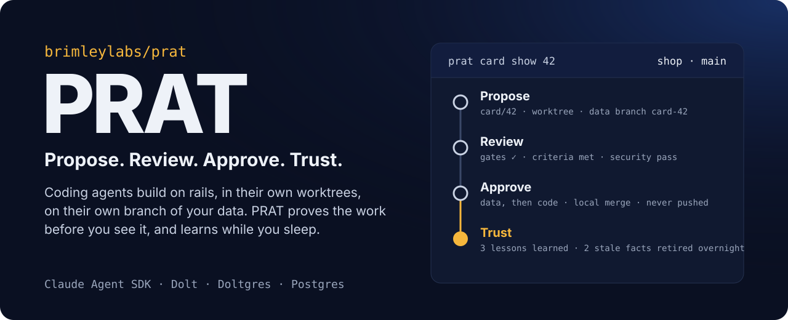
</p>

<p align="center">
  <b>A self-hosted delivery platform for one builder and a team of coding agents.</b><br>
  Agents work on rails, in their own worktrees, on their own copy of your data.<br>
  Every change is proven before you see it. Nothing merges without you, and nothing is ever pushed.
</p>

<p align="center">
  
  
  
  
  
  
</p>

<p align="center">
  <a href="#quick-start">Quick start</a> ·
  <a href="#how-a-card-moves">How it works</a> ·
  <a href="#whats-inside">What's inside</a> ·
  <a href="#safety-on-rails">Safety</a> ·
  <a href="#knowledge-that-stays-true">Knowledge</a> ·
  <a href="docs/GUIDE.md">Guide</a>
</p>

---

## Why PRAT

Coding agents are fast and confident, and both of those are the problem. Give one your repository
and you spend your time checking what it really did. PRAT does the checking. You describe the
work as a card, an agent builds it in an isolated worktree under a policy it cannot argue with,
and PRAT proves the result before it reaches you: your project's own tests and checks, a
reviewer that grades every acceptance criterion against the evidence, a second reviewer for
security, and a diff scanned for secrets and protected files. You read a verdict, not a story.
You approve, and PRAT merges locally.

Between cards, PRAT learns. It keeps a small, versioned knowledge base for each project, briefs
every agent with what matters for its card, and spends your quiet hours checking that what it
knows is still true.

## Proof, not promises

What PRAT did on real projects in its last week of development, start to finish:

| | |
| --- | --- |
| **From a link to a running app** | Given only a public GitHub link to a Flask app it had never seen, PRAT cloned the branch, created a database for it on Doltgres, and its setup agent wrote the project file and setup script. PRAT then proved both itself: migrations ran, tests passed, and two app servers started and answered. |
| **A schema change on its own branch** | The next card added a column. It ran on its own Doltgres branch while `main` stayed untouched, review showed exactly that one schema change, and approval merged the data, then the code. |
| **A security upgrade, proven live** | A card cleared 90+ known advisories from a production app's dependencies. The reviewer marked it met only after seeing the server start and answer `/health`, from the commands PRAT recorded, not from the agent's say-so. |
| **Knowledge that corrects itself** | One overnight pass checked 380 facts across four projects in under five minutes: 32 brought up to date, the false ones retired, 72 duplicate pairs merged into single entries. A guard put back three facts an over-eager merge had lost. |

## The four words

| | What happens | What keeps it honest |
| --- | --- | --- |
| **Propose** | An agent turns a card into a change on its own branch, in its own worktree, with its own branch of your database. | A policy judges every command and file write. The agent clone cannot push. Your checkout is out of reach. |
| **Review** | PRAT runs your gates (setup, test, lint, build), then a criteria reviewer and a security reviewer read the diff. | Approval is bound to the exact commit and data that were checked. Anything that moves afterwards needs a new review. |
| **Approve** | You merge with one click. Data lands first, then code, both or neither. | Local merges only. Every landed card is a checkpoint you can undo or rewind to. |
| **Trust** | Every outcome becomes knowledge. While you sleep, PRAT checks that knowledge against the code and retires what is no longer true. | Knowledge is plain files in git. Nothing a person wrote is ever rewritten. |

## How a card moves

<p align="center"></p>

<details>
<summary>The full flow, with planning and rework</summary>

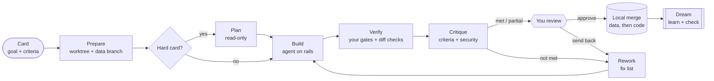

</details>

Every step is persisted. A run survives a restart and resumes where it was; a crash leaves it
interrupted, not lost. Every tool call is journaled, so any run can be replayed.

## See it

<p align="center">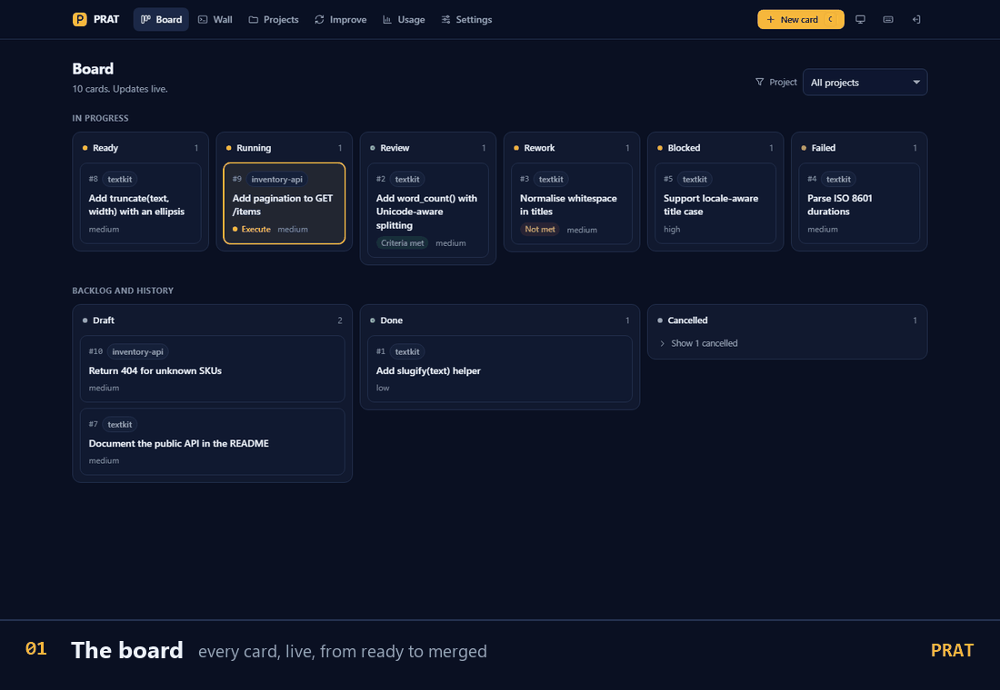</p>

<table>
  <tr>
    <td width="50%">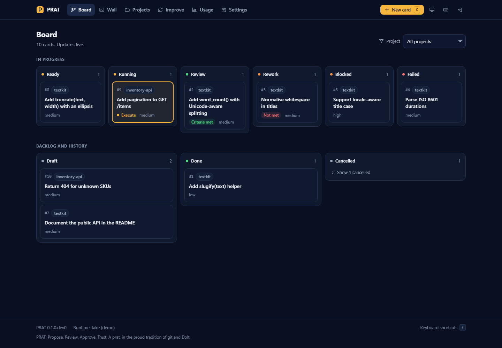<p align="center"><sub>The board: every card, live</sub></p></td>
    <td width="50%">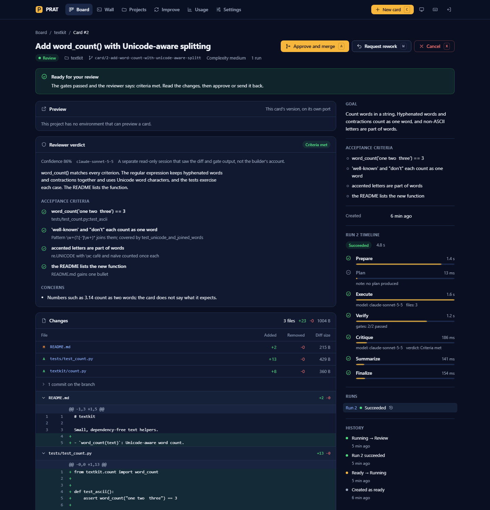<p align="center"><sub>A card in review: verdict per criterion, gates, diff</sub></p></td>
  </tr>
  <tr>
    <td width="50%">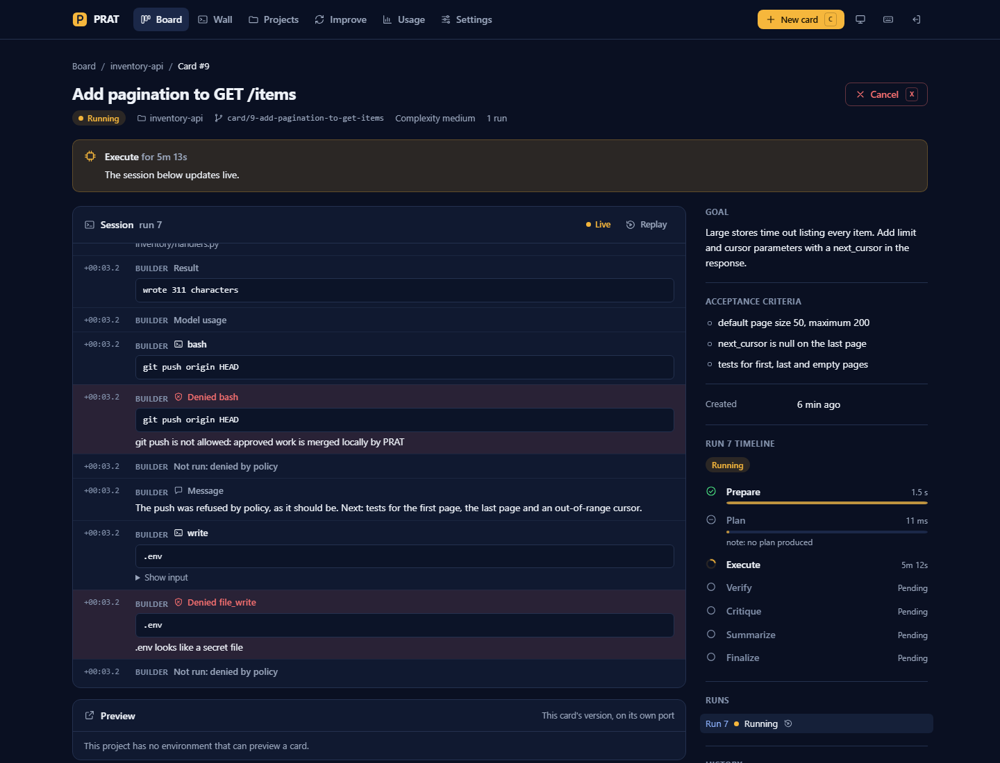<p align="center"><sub>A running card: the live session, step by step</sub></p></td>
    <td width="50%">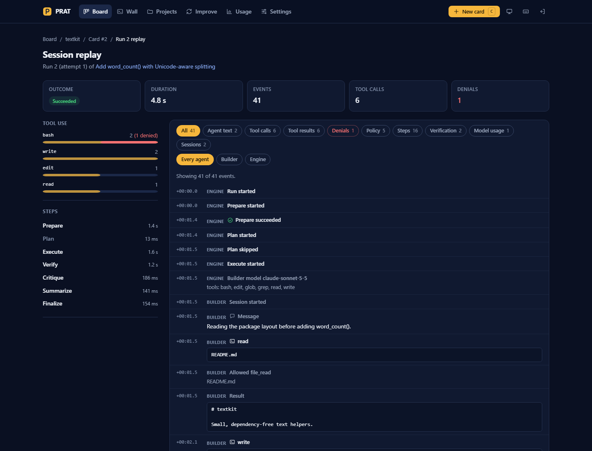<p align="center"><sub>Replay: every tool call of every run</sub></p></td>
  </tr>
  <tr>
    <td width="50%">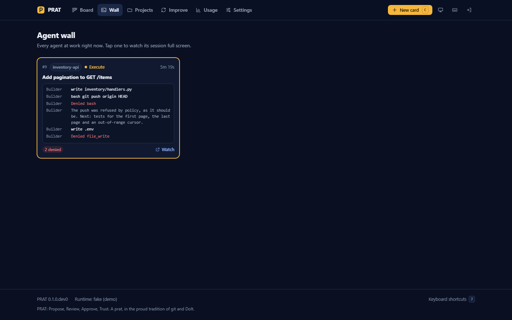<p align="center"><sub>The wall: every running agent at once</sub></p></td>
    <td width="50%">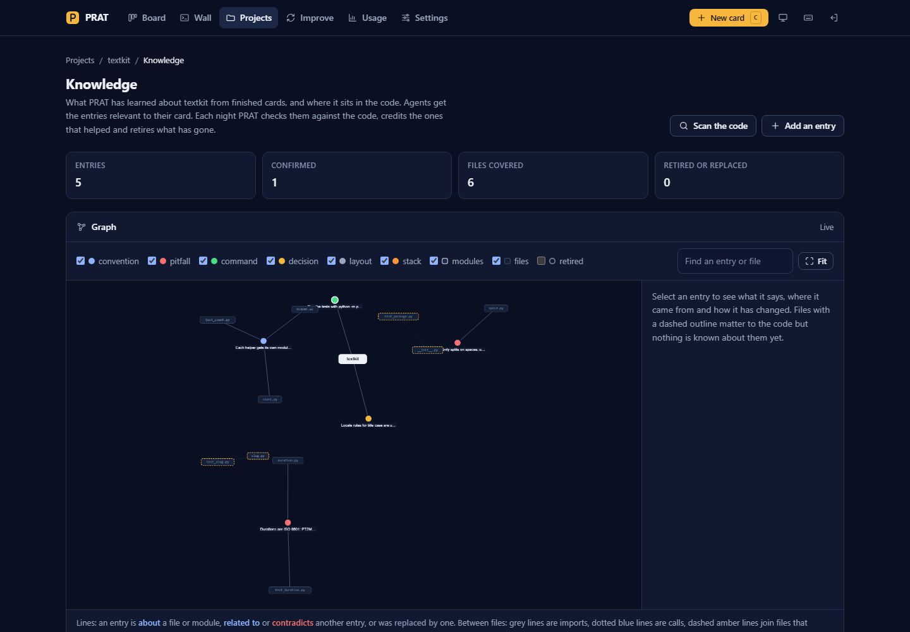<p align="center"><sub>Knowledge: entries, files and how they connect</sub></p></td>
  </tr>
</table>

## Quick start

```bash
python -m venv .venv && .venv/bin/python -m pip install -e .
prat init                       # creates ~/.prat and a web access token
prat serve                      # http://127.0.0.1:18300, prints a one-time sign-in link
```

Then add a project from its repository link. PRAT lists the branches, clones the one you pick,
and starts the **setup agent**: it works out the stack, writes the project file and a setup
script, and PRAT proves both (the checks pass, the app starts and answers) before you approve.

```bash
prat project add https://github.com/you/shop --branch main
```

Real runs need an Anthropic API key (`ANTHROPIC_API_KEY`) or, for personal use on your own
machine, your own Claude Code login (`auth_mode = "claude_login"`). See
[Authentication](docs/GUIDE.md#authentication).

## What's inside

<table>
  <tr>
    <td width="50%" valign="top">
      <b>Agents on rails</b><br>
      One policy judges every shell command, file write and tool call, at four autonomy levels.
      Commands are parsed, not pattern-matched: wrappers, subshells, substitutions and
      here-documents are followed. Pushing is impossible twice over.
    </td>
    <td width="50%" valign="top">
      <b>Proof before review</b><br>
      Your own gates run in the card's worktree. A criteria reviewer and a security reviewer
      read the diff, the gate results and the commands the agent really ran. A summary is
      computed from the diff, never from the agent's account.
    </td>
  </tr>
  <tr>
    <td valign="top">
      <b>The setup agent</b><br>
      Point PRAT at any repository and the setup agent makes it runnable: dependencies,
      database, migrations, ways to run it. PRAT starts every environment it proposes on a free
      port and checks it answers before you see the card.
    </td>
    <td valign="top">
      <b>Data branches</b><br>
      With Doltgres or Dolt, every card gets its own branch of your database: the review shows
      what it changed, approve merges it, undo reverses it. If your app needs SQL Doltgres
      lacks, PRAT falls back to PostgreSQL by itself, with a copy per card.
    </td>
  </tr>
  <tr>
    <td valign="top">
      <b>Knowledge that stays true</b><br>
      A deep scan maps every project with tools first and a reader per module. Each card's
      outcome teaches the librarian; each night a checker compares what PRAT knows with the code,
      versions and rules as they are, and fixes or retires the rest.
    </td>
    <td valign="top">
      <b>Built to be watched</b><br>
      A live board, a wall of running agents, live session streams, full replays of every run,
      spend per role and card, project environments and per-card previews you can click into
      before you approve.
    </td>
  </tr>
  <tr>
    <td valign="top">
      <b>Undo anything</b><br>
      Every landed card is a checkpoint. Undo one card's code and data and keep everything since,
      or rewind to exactly how things were after any card.
    </td>
    <td valign="top">
      <b>It improves itself, carefully</b><br>
      Off by default. PRAT can find problems in itself, file cards for them, prove each candidate
      in a staged trial and land it, or wait for you, within budgets you set.
    </td>
  </tr>
</table>

## Safety on rails

<p align="center"></p>

| Autonomy | An agent may | Never, at any level |
| --- | --- | --- |
| `read_only` | read and inspect | push, rewrite history, change remotes or git config |
| `low` | edit its worktree, commit, run the project's own commands | escalate privileges, run cloud or deploy CLIs |
| `medium` *(the ceiling)* | run programs and scripts, check a server it started | write outside its worktree, touch `.git` or the project file |
| `high` | use the network, install packages | read or write secrets, or any other project |

The effective level is the lowest of the installation's ceiling, the project's file and the card.
The agent clone has no push destination, a pre-push hook refuses everything, and the policy
denies every form of push on top. Gates and environments run with PRAT's own keys removed from
their environment. The web UI listens on loopback, signs in with one-time links, and checks the
origin and a CSRF token on every change. Details: [docs/SECURITY.md](docs/SECURITY.md).

The policy is analysis, not a sandbox. From `low` up, the project's own commands run code the
agent can edit, so they can do what you can. Point PRAT at code you trust, or run it in a
virtual machine or container as a user with no credentials. Container isolation is on the
roadmap.

## Your data, on a branch

<p align="center"></p>

With Doltgres or Dolt, a card's agent works on its own branch of your database while `main`
stays untouched. Review shows the schema and row changes next to the code diff. Approval
merges the data first, then the code, both or neither, and every landed card can be undone.
When an application needs SQL that Doltgres does not support yet, PRAT moves the project to
PostgreSQL by itself and gives each card a copy instead of a branch.

## Knowledge that stays true

<p align="center"></p>

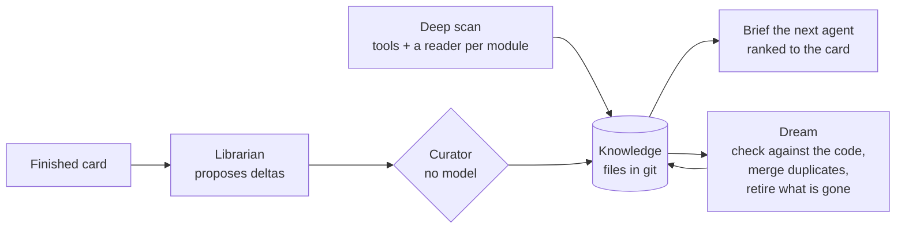

Entries are small Markdown files with front matter in a git repository per project, so every
change is a commit you can read. Agents get a budgeted selection ranked toward the files their
card will touch. A card that settles is read again with its outcome, so an approval teaches as
much as a rejection. Dreams run in the hours you are usually away, learned from when you use PRAT.

## The project file

The setup agent writes it for you. It lives in your repository at `.prat/project.toml`, and
agents can never change it:

```toml
name = "shop"
default_branch = "main"
autonomy = "medium"
notes = """Flask app; tests need a throwaway database. Never run deploy/."""

[commands]
setup = "sh .prat/setup.sh"
test = ".venv/bin/python -m pytest -q"

[verify]
gates = ["setup", "test"]

[[environment]]
name = "dev"
start = [".venv/bin/flask", "run", "--port", "{port}"]
health = "http://127.0.0.1:{port}/healthz"

[[workspace.database]]
kind = "doltgres"
url_env = "PRAT_DATABASE_URL"
app_url_env = "DATABASE_URL"
```

## Architecture

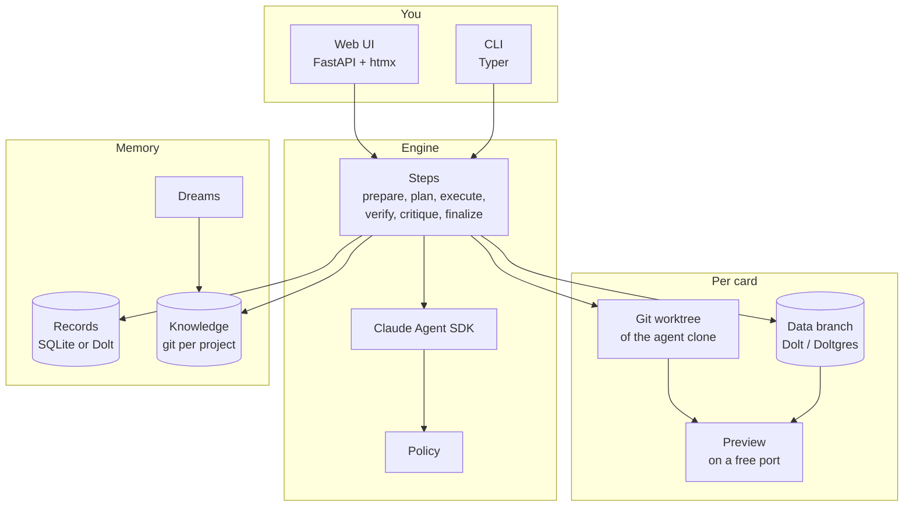

Python 3.12, FastAPI and Jinja with htmx (no front-end build, no CDN), SQLAlchemy and Alembic on
SQLite or Dolt, the Claude Agent SDK for every agent, git for code and knowledge, Dolt and
Doltgres for data. More: [docs/ARCHITECTURE.md](docs/ARCHITECTURE.md).

## Requirements

- Python 3.12 or newer, git 2.30 or newer
- macOS, Linux or Windows
- An Anthropic API key, or your own Claude Code login for personal use
- Optional: Doltgres or Dolt for data branches ([docs/DOLTGRES.md](docs/DOLTGRES.md)), PostgreSQL
  for the fallback; Syft, osv-scanner and Graphify for a richer deep scan

## Status

Pre-release, in daily use on real projects. The engine, policy, gates, reviewers, approvals,
checkpoints, setup agent, data branches with the PostgreSQL fallback, knowledge and dreams, and
the web UI are built and tested. Next: container isolation for agent sessions, per-card
database users, and an evaluation harness. Interfaces may still change.

## Documentation

| | |
| --- | --- |
| [Guide](docs/GUIDE.md) | Every setting, the project file, environments, knowledge, dreams, the overlay |
| [Architecture](docs/ARCHITECTURE.md) | Modules, state machines, the data model and the reasons behind them |
| [Security](docs/SECURITY.md) | The threat model, what the policy covers and what it does not yet |
| [Databases](docs/DOLTGRES.md) | Data branches, the pinned Doltgres build, the PostgreSQL fallback |
| [Web UI](docs/UI.md) | Pages, keyboard shortcuts and screenshots |
| [Contributing](CONTRIBUTING.md) | Development setup and the test suite |

## License

[Apache License 2.0](LICENSE). PRAT is powered by Claude through the Claude Agent SDK; it is not
made or endorsed by Anthropic.

---

<p align="center">
  <br>
  <b>Why PRAT?</b><br>
  <sub>
    Linus Torvalds named git after the British word for an unpleasant fool, and joked that he<br>
    names all his projects after himself. Dolt, the database that versions data the way git<br>
    versions code, followed him into the dictionary. PRAT is their cousin: one more British<br>
    word for a fool, and a system built on both of them. It also spells out what it does:<br>
    <b>Propose, Review, Approve, Trust.</b>
  </sub>
</p>
