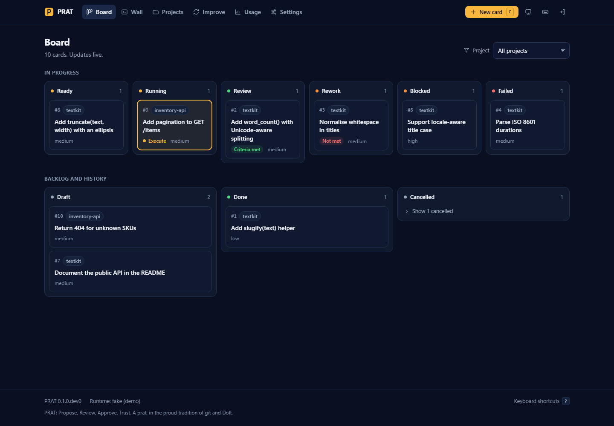

# The PRAT guide

The full reference: setup, settings, the project file, environments, knowledge and dreams. For the
overview, see the [README](../README.md).


PRAT is a self-hosted platform for running an autonomous coding agent against your own git
repositories, one work item at a time. You file a card ("add rate limiting to the login
endpoint"), and PRAT gives it to an agent that works in an isolated git worktree. Before the
work reaches you, PRAT checks it: every tool call goes through a policy, the project's own test
and lint commands must pass, an empty or oversized diff fails the run, the diff is scanned for
secrets, and a reviewer grades the result. You approve, and PRAT merges the branch locally. It
never pushes.

**Status: pre-release.** Phases 1 to 3 are in place: the Claude Agent SDK runs the builder, an
optional planner and a read-only reviewer, every tool call goes through PRAT's policy, a card
goes from ready to a local merge with a real model, and a web UI (`prat serve`) shows the board,
live sessions, replays and reviews. An optional sandbox runs a card's commands in containers
(see [The sandbox](#the-sandbox) and [docs/SECURITY.md](SECURITY.md)).
Interfaces may change without notice.



PRAT is powered by Claude through the Claude Agent SDK. It is not made or endorsed by Anthropic.

## How it works

1. You register a repository. PRAT never runs an agent in your own checkout. It makes a
   separate clone (by default `<your-checkout>-agent`) and disables pushing from it.
2. You add a card with a goal and acceptance criteria.
3. A run creates the branch `card/<id>-<slug>` and a worktree for it, then moves through
   persisted steps: prepare, plan (cards of complexity `high` only), execute, verify, critique,
   summarize, finalize.
4. The reviewer, a separate read-only agent session, grades the diff and the gate results
   against the acceptance criteria: `met`, `partial`, `not_met` or `wrong`. `met` and `partial`
   put the card in `review`; `not_met` and `wrong` send it back to `rework` with a fix list.
   A card can also end `blocked` (the agent asked a question), `failed` or `cancelled`, each
   with a reason. The summary on the card is computed from the actual diff, not from what the
   agent says it did.
5. `prat card approve` merges the branch into the default branch of the agent clone with
   `--no-ff`. You pull it into your checkout when you choose.

## Requirements

- Python 3.12 or newer
- git 2.30 or newer on `PATH`
- Linux, macOS or Windows
- For real runs: an Anthropic API key, or (personal use only) your own Claude Code login. The
  Claude Code executable comes bundled with the `claude-agent-sdk` dependency.

## Authentication

PRAT has two authentication modes, set with `auth_mode` in `$PRAT_HOME/config.toml` (or
`PRAT_AUTH_MODE`). `prat auth status` tells you which mode is active and whether it works,
without printing any secret.

**`api_key` (the default).** PRAT passes an Anthropic API key to the agent process. It reads
`ANTHROPIC_API_KEY` from the environment, or `anthropic_api_key` from the config file if you
cannot set an environment variable. This is the mode to use for anything beyond one person
experimenting on their own machine, and the only correct one for a team: each person runs PRAT
with their own key. Anthropic's Max, Ultra and Team plans include monthly API credits that work
with the Agent SDK, which is a compliant way to use a plan's allowance with PRAT.

**`claude_login` (opt in, personal use).** PRAT runs the unmodified Claude Code executable and
lets it use the login you made yourself with `claude /login` (or `claude setup-token`). PRAT
never reads, copies, stores or forwards that login: it only asks the executable whether it is
signed in. Usage counts against your own plan's limits.

Why the default is the API key: Anthropic's documentation says products built on the Agent SDK
should use API key authentication, and that third-party developers may not offer claude.ai
login or route requests through Free, Pro, Max or Ultra plan credentials on behalf of their
users, nor collect, store or intermediate those credentials. It does allow a person to sign in
to the unmodified Claude Code binary with their own subscription. `claude_login` exists for
exactly that case: you, on your own machine, on your own plan. Do not use it to run cards for
other people, and do not share one login across a team. Terms change often; read
[Anthropic's legal and compliance page](https://code.claude.com/docs/en/legal-and-compliance)
before enabling it.

## Quick start with the web UI

```bash
python -m venv .venv
.venv/bin/python -m pip install -e .          # Windows: .venv\Scripts\python.exe
alias prat=".venv/bin/python -m prat"

prat init                                     # also creates the web UI access token
prat serve                                    # http://127.0.0.1:18300, prints a login link
```

Open the one-time link that `prat serve` prints. It signs you in and expires after ten minutes
or one use; `prat login-url` prints a new one, and the login page also accepts the token from
`$PRAT_HOME/access-token`. From the UI you add projects, file cards, watch the agent work live,
read the reviewer's verdict and the diff, send cards back for rework and approve merges. The
engine runs inside the server with the same queue and limits as the CLI.

`prat serve` listens on 127.0.0.1 only. It refuses any other address unless you pass
`--allow-remote` (or set `web_allow_remote = true`), and then you should put TLS in front of it.
`prat serve --script script.json` runs every card on the fake runtime instead of a model. See
[docs/UI.md](UI.md) for the pages, keyboard shortcuts and screenshots, and
[docs/SECURITY.md](SECURITY.md#the-web-ui) for how the UI is protected.

## Adding a project

A project is a git repository and the branch PRAT works from. On the Add project page (or with
`prat project add`), give either a repository link or the path of your own clone:

```bash
prat project add https://github.com/acme/shop --branch develop   # clone it, work from develop
prat project add ~/code/shop                                     # use a clone you already have
```

A link is cloned with this machine's git credentials into `projects_dir` (default
`~/prat-projects`); the page lists the repository's branches as you type, with its default one
chosen. PRAT then keeps its own clone for agents next to it, with pushing disabled.

If the repository has no `.prat/project.toml`, PRAT adds a **setup card** (turn it off with
`--no-setup` or the checkbox). Its agent is the only one allowed to write `.prat/`: it works out
the stack from the repository and proposes a project file (commands, gates, environments,
notes) and an idempotent `.prat/setup.sh` that installs what the project needs into the
worktree. PRAT does not take its word for it: verify loads the proposed file, runs its gates in
the card's worktree, and starts every proposed environment on a free port until its health URL
answers. You review the proposal like any card; approving it merges the project file and starts
a deep scan, so the first real card is already briefed.

With `project_database_url` set to a Doltgres server, PRAT also creates a database for the
project, records its address as `PRAT_DATABASE_URL` in the machine-only
`$PRAT_HOME/environments/<slug>.toml` (never in the repository), and the setup agent declares it
as a `[[workspace.database]]`, so every card gets its own branch of the data and a preview to
click into.

## Quick start with a real agent

```bash
python -m venv .venv
.venv/bin/python -m pip install -e .          # Windows: .venv\Scripts\python.exe
alias prat=".venv/bin/python -m prat"

prat init                                     # creates ~/.prat (or $PRAT_HOME)
export ANTHROPIC_API_KEY=...                  # or set auth_mode = "claude_login", see above
prat auth status                              # mode, whether it is usable, model per role
prat project add ~/code/textkit               # reads textkit/.prat/project.toml if present
prat card add textkit "Add slugify" --ready \
  --goal "Add slugify(text) to textkit.py with tests." \
  --criteria "- slugify('Hello, World!') == 'hello-world'
- tests cover it and the whole suite passes" \
  --budget 1
prat card run 1                               # builder, gates, reviewer: card 1 -> review
prat card show 1                              # diff summary, verdict per criterion, cost
prat card approve 1                           # local --no-ff merge into the agent clone
git -C ~/code/textkit pull ~/code/textkit-agent main
```

To keep a first run cheap, use the small model for every role in `config.toml`:

```toml
[models]
builder = "claude-haiku-5-5"
critic = "claude-haiku-5-5"
planner = "claude-haiku-5-5"
```

If the reviewer sends the card back (`not_met` or `wrong`), run it again with `prat card run 1`:
the builder continues on the same branch with the reviewer's fix list. To send a card back
yourself, add a comment and move it to rework:

```bash
prat card comment 1 "Keep non-ASCII letters; add a test for it."
prat card rework 1
prat card run 1
```

## Quick start with the fake runtime

The fake runtime follows a JSON script instead of calling a model, which makes the whole
lifecycle visible without an API key.

```bash
python -m venv .venv
.venv/bin/python -m pip install -e .          # Windows: .venv\Scripts\python.exe
alias prat=".venv/bin/python -m prat"

prat init                                     # creates ~/.prat (or $PRAT_HOME)
prat project add ~/code/acme-api              # reads acme-api/.prat/project.toml if present
prat card add acme-api "Add a greet function" --goal "Add hello.greet() returning 'hi'"
```

Write a script for the fake agent, `script.json`:

```json
[
  {"op": "text", "text": "Adding greet()"},
  {"op": "write", "path": "hello.py", "content": "def greet():\n    return 'hi'\n"},
  {"op": "bash", "command": "git push origin HEAD"},
  {"op": "cost", "usd": 0.12},
  {"op": "finish", "message": "Added greet"}
]
```

Run it, inspect it, merge it (`--script` selects the fake runtime and a scripted reviewer):

```bash
prat card run 1 --script script.json          # card 1: run 1 succeeded -> review
prat card show 1 --journal                    # summary from the diff, verdict, every event
prat card approve 1                           # merges locally into the agent clone
git -C ~/code/acme-api pull ~/code/acme-api-agent main
```

The `git push` in the script is denied by the policy and recorded in the journal; it would
fail anyway, because the agent clone has no usable push destination.

Other commands: `prat card list`, `prat card cancel <id>`, `prat card comment <id> "..."`,
`prat card rework <id> [--feedback "..."]`, `prat card resume <id>`, `prat auth status`,
`prat project list`, `prat project show <slug>`, `prat db upgrade`, `prat serve`,
`prat login-url [--next /path]`, `prat rotate-token`. `prat card run` and
`prat card resume` use the Claude runtime unless `--runtime fake` or `--script` is given.

## The project file

Commit `.prat/project.toml` to the repository's default branch. PRAT reads the committed copy at
the start of each run, and agents can never edit it. Without one, no gates run before review.

For a starting point, `prat project suggest <checkout>` reads the checkout's build files
(Python with uv or poetry, Node with npm, pnpm, yarn or bun, Go, Rust, PHP, Ruby) and prints a
file with matching commands and gates. It only reads; you review the output and commit it. The
web UI shows the same suggestion on the project's page until a project file exists.

```toml
name = "acme-api"
default_branch = "main"
autonomy = "low"                               # read_only, low, medium or high
protected_paths = ["migrations/**", "*.lock"]  # never writable by the agent
secret_paths = []                              # extra files the agent may not read or write
max_diff_lines = 5000
max_diff_files = 200
notes = "FastAPI service. Tests live in tests/, one file per module."  # told to every agent

[models]                                       # optional, overrides the installation's choice
builder = "claude-sonnet-5-5"

[commands]
setup = "python -m pip install -e ."
test = "python -m pytest -q"
lint = "python -m ruff check ."

[verify]
gates = ["test", "lint"]                       # must pass before a card reaches review
timeout_seconds = 900

[review]                                       # optional
reviewers = ["criteria", "security"]           # add a second, security-only review
```

The security reviewer is a separate read-only session that looks only for changes that weaken
isolation, the policy, authentication, verification or the push rules, or handle untrusted
input unsafely. A concern sends the card back with its findings. PRAT's own repository always
has it.

Commands are split with POSIX shell rules and run without a shell. Use the list form
(`test = ["python", "-m", "pytest"]`) when an argument needs backslashes. A gate command that
runs past `timeout_seconds`, or whose run is cancelled, is killed together with every process
it started, on Linux, macOS and Windows.

## Repository instruction files

If the repository has an `AGENTS.md` or a `CLAUDE.md` at its root, PRAT gives their text to the
builder, the planner and the reviewer as the repository's guidance about its code and
conventions. Only these two names at the root are read, up to 12,000 characters each (a longer
file is cut, and the agent is told), and a symlink that points anywhere else is not followed.
Agent sessions load nothing else from the repository or from your own Claude Code setup: no
settings files, no hooks, no nested instruction files.

These files cannot change PRAT's rules. The policy, the push block and the protected paths
apply whatever they say, and the prompts tell the agents so. See
[docs/SECURITY.md](SECURITY.md#repository-instruction-files).

## Installation settings

`$PRAT_HOME/config.toml` (default `~/.prat/config.toml`), overridable with `PRAT_*` environment
variables:

| Setting | Default | Meaning |
| --- | --- | --- |
| `database_url` | SQLite at `$PRAT_HOME/prat.db` (WAL) | Any SQLAlchemy URL; Postgres works |
| `max_concurrent_runs` | 3 | Runs at once across all projects |
| `max_concurrent_per_project` | 1 | Runs at once in one project |
| `max_autonomy` | `medium` | Ceiling that no project file or card can exceed |
| `default_budget_usd` | 5.0 | Spend limit per run when the card sets none (an estimate; see below) |
| `gate_timeout_seconds` | 900 | Upper bound for each verification command |
| `auth_mode` | `api_key` | `api_key` or `claude_login` (see Authentication) |
| `anthropic_api_key` | unset | Only if `ANTHROPIC_API_KEY` cannot be set; never printed |
| `claude_cli_path` | bundled | Claude Code executable to run |
| `models` | see below | Table of role to model ID |
| `loop_threshold`, `loop_window` | 5, 8 | Same tool on the same target 5 times in 8 calls is denied |
| `web_host`, `web_port` | 127.0.0.1, 18300 | Where `prat serve` listens |
| `web_allow_remote` | false | Required to listen on a non-loopback address |
| `projects_dir` | `~/prat-projects` | Where projects added from a link are cloned |
| `project_database_url` | unset | A Doltgres server PRAT may create project databases on; never printed |
| `web_public_url` | unset | The URL people open, when it differs from host and port (reverse proxy) |
| `web_session_hours` | 12 | Session lifetime; sessions are kept in the database and survive a restart |
| `sandbox` | `off` | `docker` runs a card's commands, gates and environments in containers (see below) |
| `sandbox_image`, `docker_path` | `prat-sandbox:1`, `docker` | The default image, and the docker command |
| `sandbox_memory`, `sandbox_cpus` | `4g`, 2 | Limits for each container |

### The sandbox

On macOS or Linux with Docker (Docker Desktop, Colima or the Docker Engine), build PRAT's image
once and turn the sandbox on:

```bash
prat sandbox build            # Python 3.12, Node 22, build tools, database clients
prat sandbox check            # docker answers and the image is there
```

```toml
sandbox = "docker"            # in config.toml
```

From then on the agent's shell commands, the gates, the setup checks and the environments run
in containers that see only the card's worktree, with no network (project databases on this
machine are reached through a relay) and none of your environment variables. The agent's git
commands run there too, where the repository's git data is read-only: it can read status,
diffs and history, and PRAT commits its work when the step ends (one commit per step, with
PRAT's message). A project that needs other runtimes names its own image:

```toml
[sandbox]                     # in .prat/project.toml
image = "php:8.3-cli"         # needs sh, and socat for environments
```

With Colima, the container runtime shares only your home folder, so keep the PRAT home and
`projects_dir` inside it (the defaults are). The setup card's containers have the network, to
install dependencies; install them into the worktree (a virtual environment, `node_modules`)
so the card's later containers find them. Details: [SECURITY.md](SECURITY.md#the-sandbox).

Models per role, overridable in `[models]` here or in a project file (the project wins):

| Role | Default |
| --- | --- |
| builder | `claude-sonnet-5-5` |
| planner | `claude-opus-5-5` |
| critic | `claude-sonnet-5-5` |
| researcher, security_reviewer | `claude-sonnet-5-5` |
| scout (first look, deep scan synthesis) | `claude-opus-5-5` |
| reader (deep scan modules, the dream's checker) | `claude-sonnet-5-5` |
| librarian (lessons from cards, duplicate judge) | `claude-haiku-5-5` |
| drafter, summarizer (not used yet) | `claude-haiku-5-5` |

Costs are estimates: PRAT prices each response from its token usage and then reconciles with
the session's own reported total. With `claude_login` the figure is what the run would cost at
API prices, not what your plan charges. The budget covers the planner, builder and reviewer of
one run together; PRAT stops the session when it is exceeded, and also passes the remaining
budget to the SDK.

## Self-improvement

PRAT can work on its own source. It is off until you turn it on:

```
prat improve setup              # clone PRAT's repository to $PRAT_HOME/self/repo
prat improve on                 # cycles run inside prat serve while it is on
prat improve status
prat improve run                # one cycle now
prat improve findings --status new
prat improve dismiss 12 --note "not now"
prat improve set daily_budget_usd 3
prat improve off
```

Each cycle measures how PRAT has been doing (errors, failing gates, reviewer verdicts, policy
denials, health checks), reads `docs/ROADMAP.md`, asks a read-only researcher with web search
for practices PRAT lacks, and files the best few findings as cards on the self project. The
cards run like any other card. Limits: a daily budget, a budget per card, a cap on open self
cards and on new cards per cycle. Every decision is recorded and shown by `prat improve status`.

A self card that reaches review is landed with no person involved once it is proven: the exact
merge result passes PRAT's invariant suite as it was before the change, a staged trial (the
candidate installed and booted on its own on a spare port, then probed while it runs) and the
full gates, and both the criteria and the security reviewer passed it. Then it is merged and
pushed to the repository it came from, fast-forward only. A change that cannot be proven goes
back to the builder with the evidence, and is abandoned after `max_reworks` attempts. The
running PRAT is never changed by this; it picks up landed work when you update it. With
`prat improve mode review`, proven cards wait for your approval instead.

Research proposals that match a keyword screen (weakening a protection, adding credentials,
letting agents push) are held, not filed. `prat improve allow <id>` (or **Let it through** on the
web UI's Improve page) puts one back in the queue for the text you read; reworded later, it is
held again. Everything above is also on the Improve page.

## Environments

Declare how to run a project in its `.prat/project.toml`, and start, stop and open it from PRAT:

```toml
[[environment]]
name = "dev"
label = "Local dev"
start = "pnpm dev --port {port}"     # no shell; {port} is filled in
cwd = "apps/web"                     # relative to the repository
port = 5173
health = "http://localhost:{port}/healthz"
env = { API_URL = "http://localhost:{port}/api" }

[[environment.link]]
label = "App"
url = "http://localhost:{port}"

[[environment.link]]
label = "Admin"
url = "http://localhost:{port}/admin"
```

The project page lists each environment with its state (running, starting, unhealthy, stopped,
exited), Start, Stop and Restart, its links while it runs, and the end of its log. Stop takes
down the process and everything it started, on every system; an optional `stop` command runs
first. Environments keep running when PRAT restarts, and PRAT only stops a remembered process
after checking it is still the same one.

**Previews.** A card in review has a Preview panel: it checks out the tip of the card's branch,
starts the environment there on a free port, with the card's own database branch when the
project has one, so you can use the change before approving it. Set `preview = false` for an
environment that should not be previewed.

Machine-specific details (a port, a local host name, extra variables, different links) go in
`$PRAT_HOME/environments/<slug>.toml`, not in the committed file:

```toml
[dev]
port = 8080
env = { APP_URL = "http://shop.test:{port}" }

[[dev.link]]
label = "Shop"
url = "http://shop.test:{port}"
```

From a terminal: `prat env list <slug>`, `prat env start <slug> <name>`, `prat env stop <slug>
<name>`, `prat env log <slug> <name>`. Environments run the project's code with your user's
rights, like its gates; PRAT's own settings and keys are not passed to them.

A project whose repository should not carry environments can have them on this machine only:
put the same `[[environment]]` entries in `$PRAT_HOME/environments/<slug>.toml`, plus
`[[link]]` entries (a label and a URL) for things that already run on their own, such as a site
a local web server serves. They appear on the project page like any other.

## Your overlay

An installation can carry its own rules, guidance and settings without changing PRAT. They live
in `$PRAT_HOME/overlay`, a git repository of its own that PRAT reads at the start of every run and
that upgrades never touch:

```
prat overlay init               # create it, with overlay.toml (overlay_api = 1)
prat overlay show               # what it adds, and anything switched off
prat overlay validate
prat overlay log
prat overlay undo <commit>
```

- `rules/*.toml`: commands the agent may never run (`[[deny_command]]`, a glob such as
  `"make deploy*"`), paths it may never write or read (`[[deny_path]]`), change categories that
  always need a person (`require_person`), extra change rules (`[[change_rule]]`) and lower diff
  limits (`[limits]`).
- `prompts/<role>.md`: extra guidance for `builder`, `planner`, `critic`, `security_reviewer` or
  `researcher`, appended after PRAT's own instructions, which win where they differ.
- `settings.toml`: `[models]` per role. `config.toml` still wins.

The overlay can add and tighten; nothing in it can loosen PRAT's rules. A file PRAT cannot read,
or a feature this version does not know, is switched off and listed with the reason; the rest
still applies. The Improve page shows all of this and undoes a change in one click. The design,
including self-improvement writing to the overlay, is in
[docs/design/overlay.md](design/overlay.md).

## Project knowledge and dreams

PRAT learns about each project as cards finish: conventions it follows, pitfalls that cost a
rework, commands that matter, decisions and where things live. Each fact is a short entry in a
git repository of its own under `$PRAT_HOME/knowledge/projects/<slug>`, tied to the files it is
about and to the cards it came from.

A new project starts with a deep scan (Seed on the Knowledge page, or `prat knowledge seed`).
Tools build an inventory without a model: every tracked file classified, modules, imports and
calls, history and files that change together, declared and installed versions of the project's
own ecosystems, runtimes and known vulnerabilities. Then one reader per code module reads every
code, config and doc file, eight at a time, while data and assets are probed by type rather than
read; a synthesis pass adds what holds across the project. `--quick` runs the older first look
instead: one scout session that writes up to twelve entries. Entries the screen flags as
weakening a protection are held for you to let through or drop.

Agents get only what is relevant. PRAT maps the project's files and imports, ranks them toward
what a card is about, and gives the builder, planner and reviewer the entries about the
highest-ranked files, within a budget. Which entries each run was given is recorded with the run.

Knowledge is kept true in PRAT's quiet hours. PRAT learns when you use it (only counts per hour
of the week are kept) and dreams when you usually do not, stopping as soon as you come back or a
card of yours starts:

- **Tidy**: previews of finished cards are removed.
- **Remember**: a small, tool-less model session reads what each finished card taught (rework
  feedback, the reviewer's fix list, your comments, denied actions, failed and passing checks)
  and proposes changes; PRAT screens them for secrets and rule changes, folds duplicates and
  never rewrites an entry you wrote. A card read while it was still in review is read again once
  you approve or cancel it, and what the landed code makes untrue goes stale at once. Entries
  given to a card that landed first time are credited.
- **Check**: every dream also checks a batch of entries against the project as it is now: the
  files each is about, installed and declared versions, the project file and PRAT's own rules
  for agents (sample commands run through the real policy). What is no longer true goes stale;
  what is out of date is rewritten; an entry you wrote is never changed, and a doubt about it
  goes to `LINT.md`. Entries are checked again when their files change or after two weeks.
  Look-alike entries are put to the librarian and folded into the fuller one.
- **Reflect**: PRAT's own diagnostics.

```
prat knowledge list <slug>            # show | add | confirm | retire | graph | reindex
prat knowledge seed <slug>            # a first look: the scout writes starter entries
prat dream status                     # awake or dreaming, the window, recent dreams
prat dream now                        # dream now (waits for your running cards)
prat dream hours learn|fixed|never    # --start/--end/--timezone for fixed hours
```

The Knowledge page shows the graph and the entries; the Improve page shows your hours and each
dream. The design and the research behind it are in
[docs/design/knowledge.md](design/knowledge.md).

## Evaluating agents

The evaluation harness measures whether PRAT's gates, reviewers and rework make the work an
agent hands over better than the agent's first attempt, and whether a change to prompts,
policy, gates, models or your overlay makes things better or worse.

```bash
prat eval run                          # the built-in suite, scripted (no model)
prat eval run --runtime claude         # a real builder and real reviewers
prat eval run --reviewer claude        # scripted work, real reviewers: how good is the review?
prat eval run ./my-cases --case login-limit --label "new critic prompt"
prat eval run evals/rich --runtime plain          # plain Claude Code on the same cases
prat eval run evals/rich --runtime claude --knowledge ~/.prat/knowledge/projects/rich --jobs 3
prat eval list                         # stored evaluations, newest first
prat eval show [ID]                    # attempt by attempt (default: the latest)
prat eval compare [A] [B]              # side by side (default: the previous and the latest)
prat eval export CARD_ID ./my-cases/some-card   # a finished card as a case
```

### How a case is scored

Each case is a small repository, a card and a **hidden check**: a command, with files the
agent never sees, that decides whether the work does what the card asked. A case's card runs
through the whole pipeline, the way any card does. When the reviewer sends it back, it runs
again with the fix list. When the gates fail, PRAT sends it back with their output, the way you
would. This repeats until the card reaches review or the case runs out of attempts. After every
run, the hidden check judges the commit the run left on the card's branch.

That gives two answers from one run:

- **The agent alone**: the first attempt is what the agent would have handed over without
  PRAT's gates, reviewers or rework. Does it pass the hidden check?
- **PRAT**: does the work PRAT finally handed over pass it?

Every attempt is also scored as **caught** (bad, sent back), **missed** (bad, handed over), a
**false alarm** (good, sent back) or **passed** (good, handed over), and each case gets an
outcome: **fixed** (bad first attempt, good work handed over), **kept**, **stopped** (bad, and
nothing handed over), **lost** (a good first attempt that never got handed over) or
**missed**. `prat eval run` prints these, the share of bad attempts caught and of good ones
sent back, and the pass rate of every step (prepare, plan, execute, verify, critique,
summarize, finalize), per project when the cases span several.

The built-in suite has six cases, scripted so that each outcome appears: right first time,
caught by a gate, caught by the reviewer, missed by everyone, good work sent back, and bad
work never handed over. A scripted run shows that the harness works. The numbers that say
something about an agent come from `--runtime claude`, `--reviewer claude`, and your own cases.
The repository's `evals/` folder has case sets on real code (see its README).

### Against plain Claude Code, and with knowledge

`--runtime plain` runs the same cases with plain Claude Code: one session with Claude Code's
own system prompt and every permission, the same model as PRAT's builder and the same budget,
given the same card, and no PRAT policy, gates, reviewer or rework. Whatever it leaves is
handed over and judged by the same hidden check. It runs on this machine even with the
sandbox on, so use it on cases you trust.

`--knowledge DIR` gives every case a project's knowledge, as PRAT would know the project in
use: seed a project once (`prat knowledge seed`), let dreams improve it, and pass its folder
(`$PRAT_HOME/knowledge/projects/<slug>`). Run with and without it, and against `plain`, and
`prat eval compare` shows what each layer adds. `--jobs N` runs N cases at once; each has its
own home, so they never share a card or a branch.

### Safety

Every case runs in a PRAT home of its own, under `$PRAT_HOME/evals/<id>/work/`, with its own
SQLite database, a fresh repository made from the case's files and its own agent clone.
Nothing reaches your projects, cards, branches or databases: a case whose project file
declares databases is refused, and no database server setting is passed on. Gates and the
hidden check run agent-written code, so they run the way gates always do: in the sandbox when
it is on, otherwise without PRAT's own settings and keys. The scratch folders are removed when
the evaluation ends (`--keep-work` keeps them). Each evaluation is stored in
`$PRAT_HOME/evals/<id>/result.json`, with the journal of every run. Your overlay's rules and
guidance apply in every case unless you pass `--no-overlay`.

### Writing a case

```
my-cases/login-limit/
  case.toml          the card, the hidden check, scripted verdicts
  repo/              the starting files, including .prat/project.toml
  project.toml       optional: the project file, put at .prat/project.toml
  hidden/            files laid over the work before the hidden check runs
  attempts/1.json    for the scripted builder: what it does on the first run
  attempts/2.json    ... and on the next, after the card was sent back
```

```toml
title = "Limit login attempts"
goal = "Lock an account for 15 minutes after five failed logins."
acceptance_criteria = """
- the sixth failed login within 15 minutes is refused with 429
- a successful login resets the count
"""
complexity = "medium"
max_attempts = 3            # the first run plus reworks

[check]
command = ["{python}", "-m", "pytest", "-q", "hidden_tests"]
timeout_seconds = 300

[[scripted_review]]         # the scripted reviewer's verdict on each review, in order
verdict = "not_met"         # met, partial, not_met or wrong
summary = "A success does not reset the count."
fix_list = ["reset the count after a successful login"]
```

A case can start from a commit of a public repository instead of carrying its files:

```toml
[source]
repository = "https://github.com/Textualize/rich.git"
commit = "3a109ccd..."      # the full commit id
```

PRAT keeps one clone of each repository under `$PRAT_HOME/evals/sources` and gives the agent
that commit's files with no history, so it cannot see what came after; `repo/`, if present,
is laid over them (a planted bug, or tests taken out). Files a library marks export-ignore,
such as its tests, are included.

`{python}` in the check and in the project file becomes this machine's Python, or `python3`
in the sandbox. The attempts are scripts for the scripted runtime: the same steps as
`prat card run --script` (write, edit, delete, bash and the rest). A real agent ignores them
and works from the card. A case without attempts runs only with `--runtime claude`.

### Replaying a finished card

`prat eval export` turns a finished card into a case: the files of the commit its first run
started from, the card, each run's journal, and how each run went (gates, verdict and how many
of the builder's commands the policy denied). Each run becomes an attempt that replays it: the
builder's shell commands go back through today's policy without being run, then the files the
run changed are written as they were at the end of it. Gates and reviewers then judge the
replayed work for real, and `prat eval show` puts each attempt next to its recording. Binary
files and files over 1 MB are not replayed, and the export says which. An exported case has no
hidden check until you add a `[check]` table and a `hidden/` folder; until then it reports
gates, verdicts and policy only.

## Documentation

- [docs/ARCHITECTURE.md](ARCHITECTURE.md): modules, state machines, data model and the
  reasons behind the main decisions.
- [docs/SECURITY.md](SECURITY.md): the threat model, what the policy covers and what it
  does not yet cover.
- [docs/UI.md](UI.md): the web UI, its pages, shortcuts and screenshots.
- [CONTRIBUTING.md](../CONTRIBUTING.md): development setup and running the tests.

## License

Not yet chosen. It will be decided before the first release.
