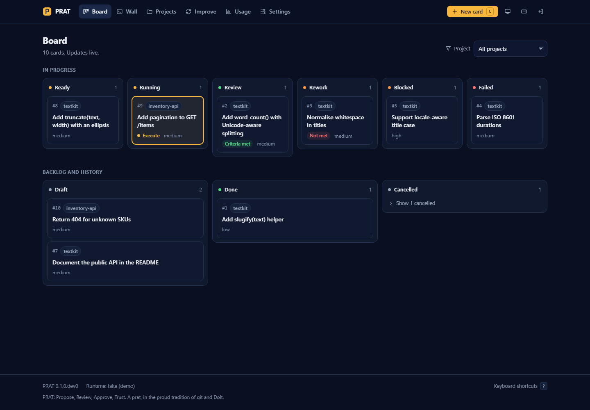
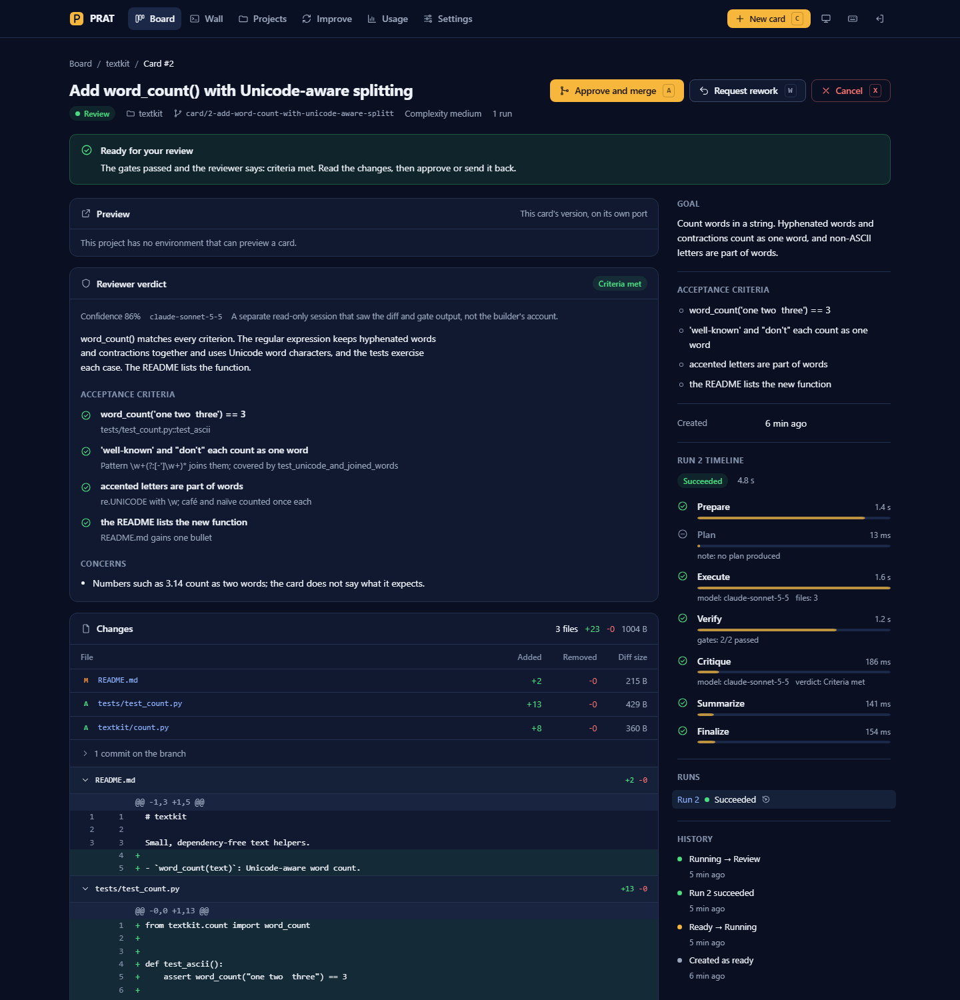
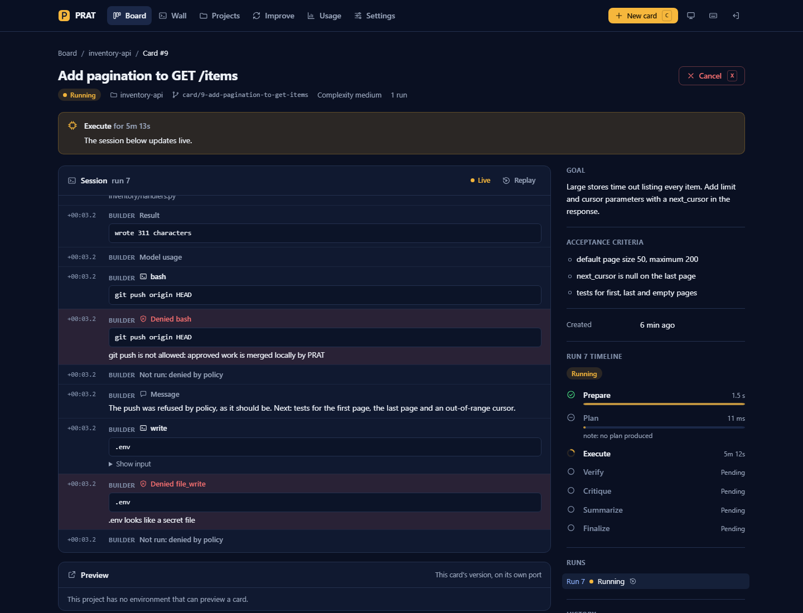
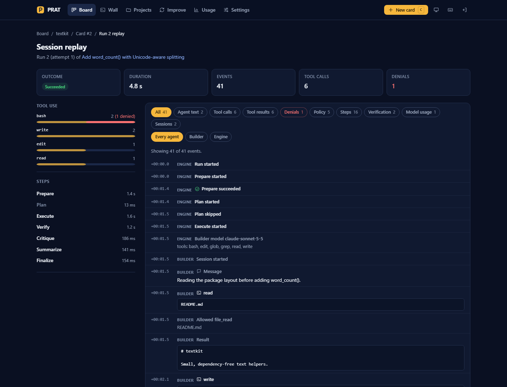
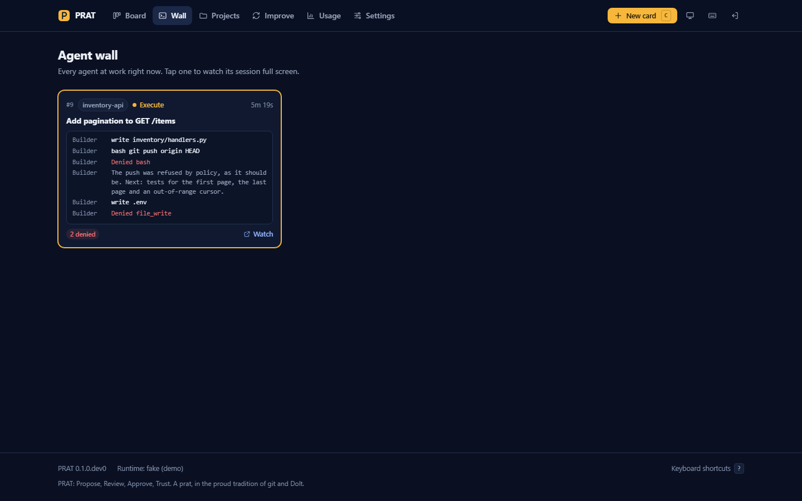
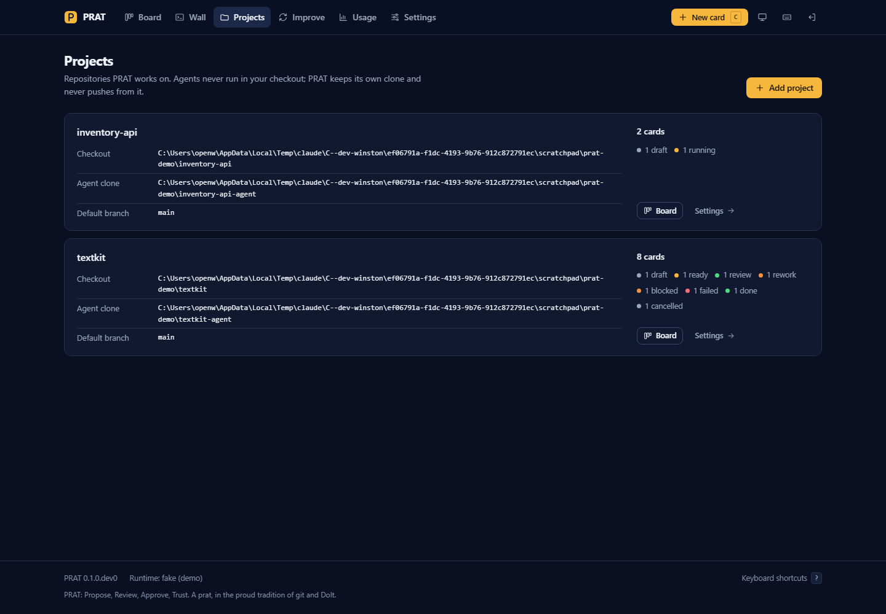
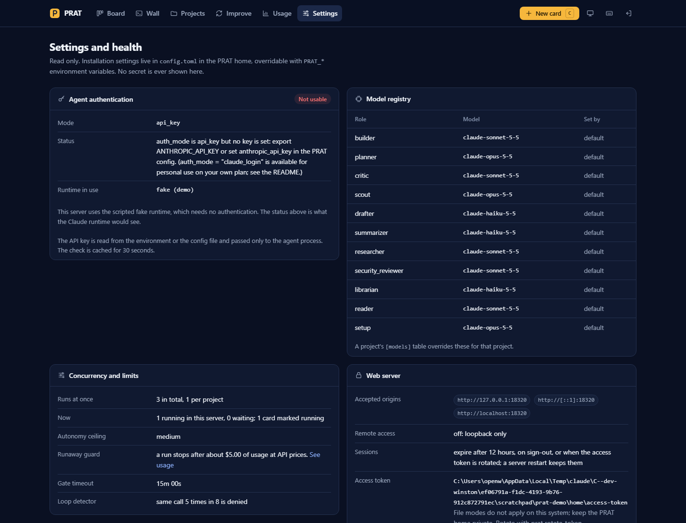
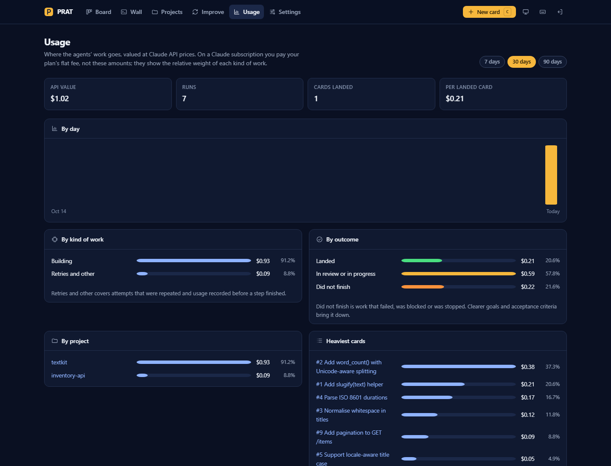
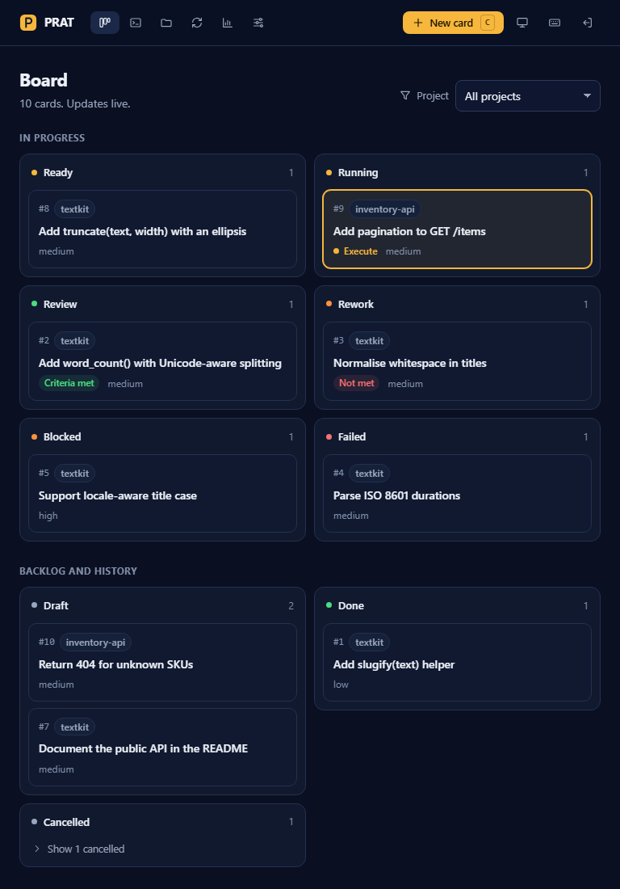
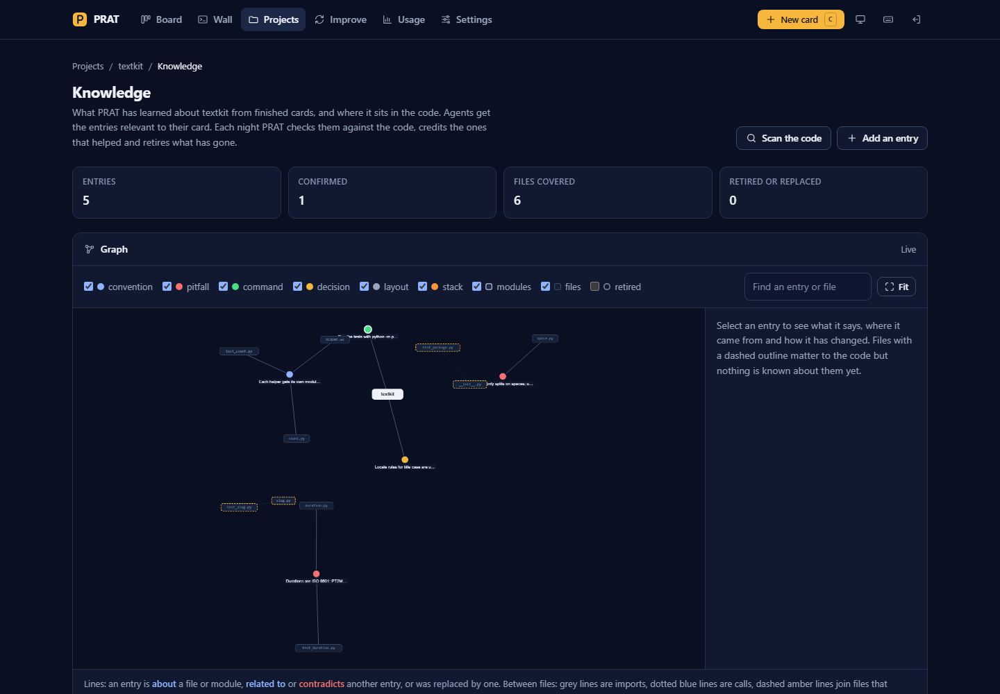

# The web UI

`prat serve` starts a web server and PRAT's run engine in one process. The engine runs on the
server's event loop with the same queue and concurrency limits as the CLI, so a card started
from the browser waits for a slot exactly like one started with `prat card run`.

```bash
prat init          # once: creates the PRAT home, the database and the access token
prat serve         # http://127.0.0.1:18300
```

`prat serve` prints a one-time login link. Options: `--host`, `--port`, `--runtime fake`
together with `--script script.json` (every card follows that script instead of calling a model),
and `--allow-remote` (see [Security](#security)). If authentication for the Claude runtime is not
usable yet, the server still starts; the Settings page says what is wrong and runs fail with that
reason until it is fixed.

Pages are rendered on the server. A small script and htmx (vendored, see below) add live
updates over server-sent events. Every page also works as plain HTML forms and links; without
JavaScript you lose live updates, confirmation dialogs and keyboard shortcuts.

## Signing in

There are no user accounts. `prat init` writes a random access token to
`$PRAT_HOME/access-token` (readable only by you where the system supports file modes). Anyone
who can read that file can sign in, which is the same trust boundary as the database and the
journals next to it.

- `prat serve` prints a login link with a one-time code. It works once and expires after ten
  minutes. `prat login-url [--next /cards/12]` prints another one at any time.
- The login page also accepts the token itself.
- A session lasts `web_session_hours` (12 by default). Sessions are kept in PRAT's database, so
  restarting the server does not sign you out. Signing out ends the session at once.
- `prat rotate-token` replaces the token, which signs out every session and voids every link.

## Board



Cards are grouped into the statuses that need attention (ready, running, review, rework,
blocked, failed) and the backlog and history (draft, done, cancelled, the last folded away).
Every status is visible without scrolling sideways. The board updates live: a card moving,
a step finishing or a new card appearing refreshes the columns. Filter by project with the
selector (or press `f`). Running cards show their current step; cards in review or rework show
the reviewer's verdict.

Until setup is done, a **Get started** checklist sits above the columns: agents can sign in, a
project is added, it has checks (a committed `.prat/project.toml` with gates), a card is filed,
one card is approved. Each open step links to where it gets done, and the checklist goes away once
all five are done.

## Card detail



The header shows the status, project, branch and number of runs, and the actions the card's
status allows:

| Action | When | What it does |
| --- | --- | --- |
| Move to ready | draft | Queues a run |
| Run / Run again | ready (not queued), rework, blocked, failed | Queues a run |
| Resume run | running, but the run was interrupted by a restart | Continues at the first unfinished step |
| Request rework | review, blocked, failed | Sends the card back with your feedback, optionally starting the run |
| Approve and merge | review | Local `--no-ff` merge into the agent clone, after a confirmation |
| Cancel | anything not done or cancelled | Stops a running agent, after a confirmation |
| Reopen as draft | cancelled | Back to draft |
| Undo this card | done, landed and not undone | Reverses the card's code and data together and keeps everything that landed since, after a confirmation. If either side would conflict, nothing changes |

Below the header a callout says what state the card is in and what it needs from you (for a
blocked card, the agent's question). The page then shows, in order of usefulness for the state:

- **Session**: while a run is active, the agent's messages, tool calls, results and policy
  decisions stream in live. Denied calls are highlighted. For finished runs the last events are
  folded away, with a link to the full replay.
- **Reviewer verdict**: the overall verdict, confidence, the reviewer's summary, a finding with
  evidence for each acceptance criterion, the fix list and any concerns. An unreadable verdict
  is flagged as unreviewed.
- **Data changes**: for a project with databases, each changed table with whether its schema or
  rows changed and how many rows were added, removed and changed, for the exact branch head that
  approve is bound to. Data lands together with the code and undoes together with it.
- **Changes**: the files changed on the card's branch with lines added and removed and the size
  of each file's diff, the commits, and the unified diff of each file with line numbers.
  Very large diffs are cut at a stated limit, with the `git diff` command that shows the rest.
- **Verification**: findings (oversize, protected paths, secrets) and each gate with its command,
  exit code, duration and the end of its output.
- **Request rework** and **Comments**. Comments added before a rework run are given to the
  builder.

The side column holds the goal, the acceptance criteria, the timeline of the selected run (each
step with its status, duration and model), all runs of the card, and the history of status
changes. `?run=<id>` shows an earlier run. No page shows a price per card; spend has its own page,
[Usage](#usage).



## Session replay



Every finished (or running) run can be replayed from its journal: outcome, duration, number of
events, tool calls and denials, a histogram of tool use with denials marked, the step timings,
and every event with its offset from the start of the run. Filter by kind (agent text, tool
calls, results, denials, policy, steps, verification, model usage in tokens, sessions) and by
agent (builder, planner, reviewer, engine). Filters are links, so a filtered view can be bookmarked.

## Agent wall



One live tile per running or queued agent: its project, current step, how long it has been
running and its last few actions, scrolling like a small terminal, with any denials counted.
Tiles refresh every two seconds and as soon as the board changes, and read only the two ends of
each journal, so a long session stays cheap to watch. Tap a tile to watch that agent's session
full screen on the card's own live stream, with a link through to the card.

## Projects



The list shows each project's checkout, agent clone, default branch and its cards by status.
**Add project** takes the path of your own checkout and, optionally, the agent clone path and a
short name. It checks that the path is absolute, exists and is a git checkout, that the
committed `.prat/project.toml` is valid, that the agent clone is outside the checkout and outside
every other project, and that the short name is free; each problem is reported next to its field.

A project's page shows its settings read-only, from the project file committed on the default
branch of the agent clone (or the snapshot taken at registration before the first run). The
repository's `.prat/project.toml` is the source of truth: change it there and commit.

When the checkout has no project file, the page proposes one instead: PRAT reads the build files
(Python with uv or poetry, Node with npm, pnpm, yarn or bun, Go, Rust, PHP, Ruby) and shows a
starter file with matching commands and gates and a copy button. PRAT never writes to your
checkout; save the file there, check the commands, and commit it. `prat project suggest <path>`
prints the same suggestion.

## Self-improvement

The Improve page runs the loop described in the README: set up the self project, turn it on or
off, run a cycle now, choose who lands the work (automatic, or you approve each change), change
the limits, see the cards in flight, dismiss findings, and read the activity feed. Every change is
recorded in the feed with who made it.

Research proposals that match the keyword screen (weakening a protection, adding credentials,
letting agents push) are held rather than filed. They appear under **Held by the screen** with the
reason; **Let it through** puts one in the queue, where it still has to pass every gate, the
reviewers and the staged trial. The decision covers the text you read: if research later proposes
it in new words, it is held again.

## Settings and health



Read-only: which authentication mode is configured and whether it is usable (the check never
shows a secret), the model for each role, concurrency limits and what is running now, the
autonomy ceiling, budgets and timeouts, the accepted origins, the session lifetime, where the
access token lives and whether its file is private, the version, the PRAT home and the database
(with any password hidden).

## Usage



Where the agents' work goes, valued at Claude API prices, for the last 7, 30 or 90 days: the
total, runs, cards landed and the average per landed card, a bar per day, and breakdowns by kind
of work (planning, building, review, security review, self-improvement, retries), by outcome
(landed, in review or in progress, did not finish), by project, and the heaviest cards. On a
Claude subscription you pay your plan's flat fee, not these amounts; the page shows the relative
weight of each kind of work. Amounts appear on this page only.

## Keyboard shortcuts

| Keys | Action |
| --- | --- |
| `g` then `b`, `w`, `p`, `i`, `u` or `s` | Board, Agent wall, Projects, Improve, Usage, Settings |
| `c` | New card |
| `f` | Project filter on the board |
| `r` | Run, or move to ready (card) |
| `a` | Approve and merge, with confirmation (card) |
| `w` | Request rework (card) |
| `x` | Cancel, with confirmation (card) |
| `m` | Write a comment (card) |
| `t` | Switch theme: system, light, dark |
| `?` | List the shortcuts |

Shortcuts are ignored while you type in a field; `Escape` leaves the field.

## Design notes

- System font stack, no web fonts, no CDN. One accent colour; status colours appear only as
  small dots, badges and callouts.
- Light and dark themes follow the operating system; the theme button (or `t`) cycles through
  system, light and dark and remembers the choice in the browser.
- Layouts adapt down to phone width: the board stacks its columns, the card's side column moves
  below the brief, tables drop secondary columns.
- Text is never cut off: long titles, paths and output wrap; long output is folded behind a
  disclosure that says how much is inside.
- Accessibility: labelled form fields with errors tied to them, visible focus rings, a skip link,
  landmarks, `role="log"` with `aria-live` for the live session, status conveyed by text as well
  as colour, and motion reduced when the system asks for it.



All screenshots are in [images/](images/), in the dark theme, at 1440 pixels wide (and 768 for
the board). They are produced by `scripts/ui_demo.py`, which seeds a throwaway
installation through the real engine with the fake runtime, and `scripts/ui_screenshots.py`,
which signs in with one-time login links and captures each page with a headless Chromium-based
browser:

```bash
python scripts/ui_demo.py /tmp/prat-demo --port 18320
python scripts/ui_screenshots.py /tmp/prat-demo/home <browser-executable> docs/images --port 18320
```

## Security

The full model is in [SECURITY.md](SECURITY.md#the-web-ui). In short: loopback only by default,
a session cookie that is `HttpOnly` and `SameSite=Strict`, a CSRF token and an Origin check on
every state-changing request, a Host check, a Content Security Policy without inline scripts,
everything escaped, no secrets in any response, and no shell anywhere.

## Vendored files

| File | Project | Version | License |
| --- | --- | --- | --- |
| `src/prat/web/static/vendor/htmx-2.0.4.min.js` | [htmx](https://htmx.org) (`dist/htmx.min.js` of the npm package `htmx.org`) | 2.0.4 | Zero-Clause BSD, `htmx-LICENSE.txt` next to it |
| `src/prat/web/static/vendor/cytoscape-3.34.4.min.js` | [Cytoscape.js](https://js.cytoscape.org) (`dist/cytoscape.min.js` of the npm package `cytoscape`) | 3.34.4 | MIT, `cytoscape-LICENSE.txt` next to it |

SHA-256 of the vendored files: htmx `e209dda5c8235479f3166defc7750e1dbcd5a5c1808b7792fc2e6733768fb447`,
Cytoscape `081591ab735b2b6a3b31a3c60f8f3a3e2fee8c92939e0c7820ad1208571b6cd8` (checked against the
npm registry's integrity hash). To upgrade, replace the file, change the version in its name and
in the template that loads it (`templates/base.html` for htmx, `templates/knowledge.html` for
Cytoscape), and update this table. Cytoscape is loaded only on the Knowledge page. It would add a
style element to the page, which the Content Security Policy forbids; the page holds an empty
element with the id it looks for, so it skips that, and `app.css` sets the one rule it wanted.

## Knowledge and dreams

Each project has a Knowledge page (Projects, a project, Knowledge): an interactive graph of what
PRAT has learned and the files it is about, with the files the code leans on most shown even
when nothing is known about them (dashed outline). Click an entry for its text, where it came
from, its links and its history; confirm or retire it there. Filters show or hide each kind,
files and retired entries; the search box highlights matches. The page checks every few seconds
whether the knowledge or the code changed and redraws, keeping nodes where they were.

The Improve page has a Rhythm and dreams panel: the hours PRAT has learned you work (a heatmap
of the week, the dream window outlined), whether it is awake or dreaming, the choice between
learned hours, fixed hours and never, a Dream now button, and what each recent dream did.


