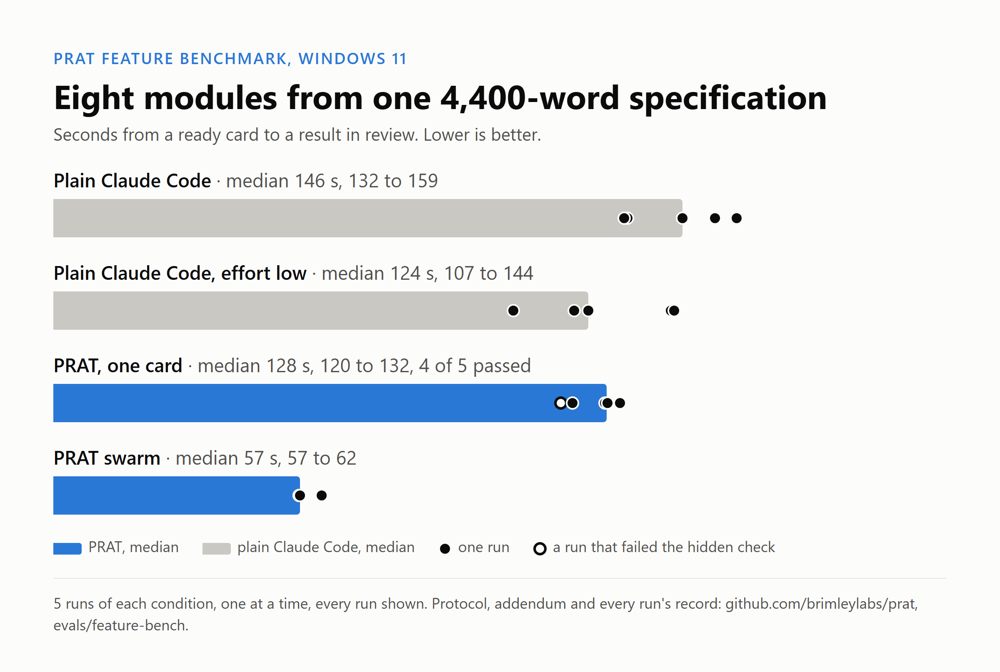
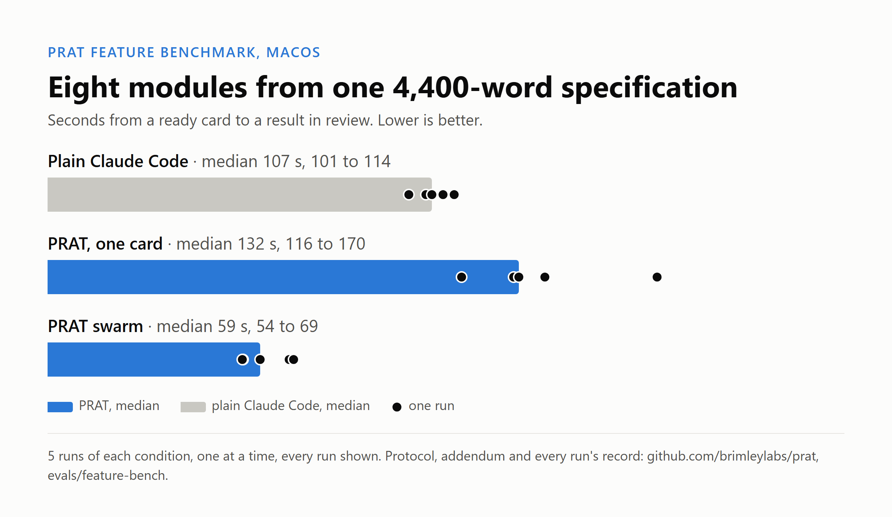
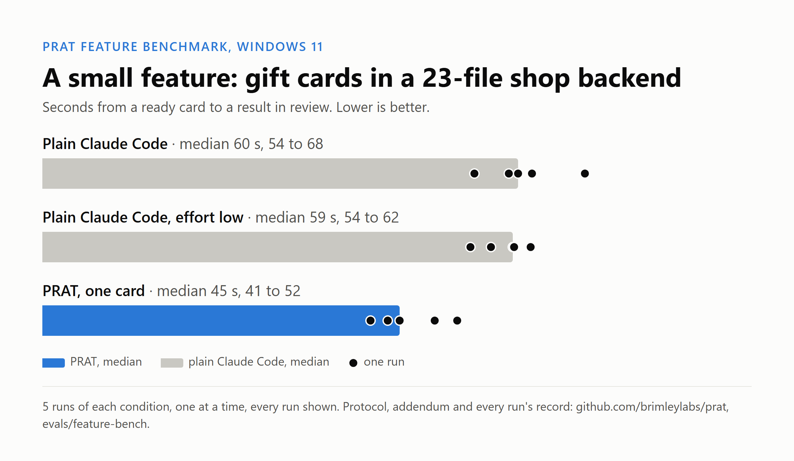
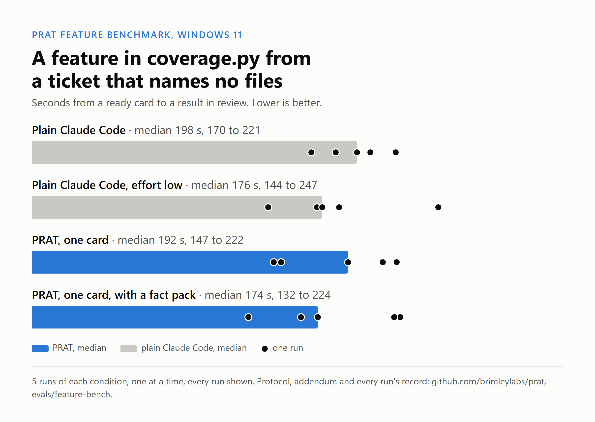

# Feature benchmark: results

Runs made on 2026-11-23 at commit `6a47d6c`, under [PROTOCOL.md](PROTOCOL.md) and
[ADDENDUM-1.md](ADDENDUM-1.md). 70 runs: 55 on Windows 11, 15 on macOS (Apple M5 Pro). Every
run's record is under [results/](results/); `report.py` prints the tables below from them and
`charts.py` draws the charts.

The protocol was written before the first run. Both addenda were written during the work and say
when: the first adds a fairer baseline, the second a look back at the journals of ten runs.

Every session, PRAT's and the plain baseline's, ran on `claude-sonnet-5-5` through Claude Code
2.1.325. PRAT ran with its defaults, which on one card means **two builders racing on the same
card, the first acceptable result kept**, then the gates and a reviewer. The plain baseline is
one session. Times are wall-clock.

## Summary

- **69 of 70 runs passed their hidden check.** The one failure was PRAT as one card on the
  eight-module case: 112 of 113 hidden tests passed, and PRAT's reviewer accepted the work.
- **A swarm roughly halves the time on a wide job, on both machines.** Eight modules took a
  median of 57 s (Windows) and 59 s (macOS) as a swarm, against 107 to 146 s for every other
  condition. It costs about five times the model spend of one plain session.
- **On one card, PRAT's gates and reviewer cost little or no wall-clock time.** PRAT races two
  builders, so this compares what a person waits for, not the work done. Against plain Claude Code
  at the same effort, PRAT was faster on the small feature (45 s against 59 s, ranges apart),
  level on the eight-module case on Windows (128 s against 124 s) and level on the coverage.py
  ticket (192 s against 176 s, ranges overlapping). On macOS, against plain at its default
  effort, PRAT as one card was slower (132 s against 107 s).
- **The fact pack cut the looking around, and the total barely moved.** With a pack the
  coverage.py ticket took a median of 174 s against 192 s without, and the ranges overlap almost
  entirely, so the protocol's own measure shows no clear difference. A look back at the journals
  ([below](#where-the-time-went-with-a-fact-pack)) shows the builder reaching its first edit
  after 4 tool calls and 15 s with a pack, against 16 calls and 45 s without. Researching and
  checking the pack took a median of 267 s and 0.90 USD before the card started.
- **PRAT costs more model spend per card:** about 1.4 to 2.2 times one plain session on a single
  card, as recorded. The true figure is somewhat higher: see the note on cost under Limits.









## Where the time went with a fact pack

This section is a look back, described in [ADDENDUM-2.md](ADDENDUM-2.md). Its measures were
chosen after the results were known, so treat it as an explanation to test, not as a finding of
the protocol. The numbers are for the builder whose work was kept, on the coverage.py ticket,
from [first-edit/windows-coverage.json](first-edit/windows-coverage.json).

| | Without a pack | With a pack |
| --- | --- | --- |
| Tool calls before the first edit, median (range) | 16 (10 to 21) | 4 (4 to 8) |
| Seconds to the first edit, median (range) | 45 (41 to 90) | 15 (13 to 70) |
| Seconds from the first edit to the end, median (range) | 114 (91 to 129) | 121 (96 to 185) |
| All tool calls, median (range) | 40 (26 to 46) | 34 (21 to 43) |

| Condition | Round | Calls before first edit | Seconds to first edit | Seconds after | All tool calls |
| --- | --- | --- | --- | --- | --- |
| PRAT, one card | 1 | 21 | 52 | 91 | 45 |
| PRAT, one card | 2 | 13 | 90 | 114 | 28 |
| PRAT, one card | 3 | 10 | 41 | 125 | 26 |
| PRAT, one card | 4 | 19 | 45 | 129 | 46 |
| PRAT, one card | 5 | 16 | 42 | 94 | 40 |
| PRAT, one card, with a fact pack | 1 | 4 | 13 | 185 | 43 |
| PRAT, one card, with a fact pack | 2 | 4 | 19 | 142 | 37 |
| PRAT, one card, with a fact pack | 3 | 8 | 70 | 110 | 21 |
| PRAT, one card, with a fact pack | 4 | 4 | 13 | 96 | 32 |
| PRAT, one card, with a fact pack | 5 | 4 | 15 | 121 | 34 |

How we read it: the pack did what it is for. In four of five runs the builder was editing within
20 s. That start is about a quarter of this build. The rest, editing and running the tests, took
91 to 185 s whatever the builder knew beforehand, and that spread is larger than the saving. In
one run with a pack (round 3) the builder still took 70 s to start.

The pack is not free. Its research took longer than the build it helped (a median of 267 s), so
it pays only where that research happens in time nobody is waiting for, which is how PRAT uses
it: on cards sitting in the backlog. This benchmark does not test whether the saving grows on a
larger or less familiar code base.

## What changed from our earlier, unpublished measurements

Before this protocol we had measured the same cases a few times each while building the
features. Two of those early figures did not hold up and are withdrawn:

- "A fact pack halves the build" (261 s to 131 s), from one run each way. Under the protocol the
  difference is 192 s to 174 s with overlapping ranges.
- "PRAT as one card takes 177 s on the eight modules." Under the protocol it takes 128 to 132 s.

The swarm figure (63 s then, 57 to 59 s now) held.

## Limits

- Three cases on two code bases, written by PRAT's author while building the features they
  test. Nobody independent chose the cases or ran them.
- PRAT on one card raced two builders against the baseline's one session. The time is what a
  person waits for; the cost columns show what that takes.
- PRAT's cost figures leave out the builder that lost the race. PRAT ends that session early and
  does not record its spend. The estimates in the journals of the Windows runs put it at about
  0.03 to 0.10 USD a card on the tinyshop cases (0.39 in one run) and 0.26 to 0.54 USD on the
  coverage.py ticket, on top of the costs in the tables. The plain baseline's cost is complete.
- Passing a hidden check is the only measure of quality here. Plain Claude Code passed all 35 of
  its runs, so these cases do not show PRAT's review catching anything the baseline missed.
- Five runs of each condition. The ranges are the result; no significance is claimed.
- The plain baseline has no gates or reviewer, so equal time is not equal assurance. One PRAT
  run shows the other side of that: a reviewer is not a guarantee either.
- The effort-matched baseline (`plainlow`) ran on Windows only.
- Timings depend on the model service on the day.

## Running it yourself

From the repository root, with PRAT installed and a Claude login:

```bash
bash evals/feature-bench/bench.sh <machine name> <work folder>      # all runs, resumable
python evals/feature-bench/report.py                                # the tables
python evals/feature-bench/charts.py                                # the charts (needs matplotlib)
python evals/feature-bench/first_edit.py <work folder> coverage     # the look back
```

The 70 runs here came to about 66 USD of model usage as the runtime reports it.

## macOS (Apple M5 Pro)

### megastore

| Condition | Passed | Median (s) | Fastest (s) | Slowest (s) | Median cost (USD) |
| --- | --- | --- | --- | --- | --- |
| Plain Claude Code | 5/5 | 107 | 101 | 114 | 0.40 |
| PRAT, one card | 5/5 | 132 | 116 | 170 | 0.89 |
| PRAT swarm | 5/5 | 59 | 54 | 69 | 2.66 |

Every run:

| Condition | Round | Seconds | Hidden check | Outcome | Pack research (s) |
| --- | --- | --- | --- | --- | --- |
| Plain Claude Code | 1 | 105.5 | passed (Ran 113 tests in 0.013s) | succeeded |  |
| Plain Claude Code | 2 | 100.8 | passed (Ran 113 tests in 0.012s) | succeeded |  |
| Plain Claude Code | 3 | 110.4 | passed (Ran 113 tests in 0.012s) | succeeded |  |
| Plain Claude Code | 4 | 113.5 | passed (Ran 113 tests in 0.012s) | succeeded |  |
| Plain Claude Code | 5 | 107.3 | passed (Ran 113 tests in 0.011s) | succeeded |  |
| PRAT, one card | 1 | 138.7 | passed (Ran 113 tests in 0.027s) | review |  |
| PRAT, one card | 2 | 115.6 | passed (Ran 113 tests in 0.012s) | review |  |
| PRAT, one card | 3 | 170.1 | passed (Ran 113 tests in 0.014s) | review |  |
| PRAT, one card | 4 | 130.1 | passed (Ran 113 tests in 0.014s) | review |  |
| PRAT, one card | 5 | 131.6 | passed (Ran 113 tests in 0.013s) | review |  |
| PRAT swarm | 1 | 67.4 | passed (Ran 113 tests in 0.017s) | review |  |
| PRAT swarm | 2 | 59.3 | passed (Ran 113 tests in 0.020s) | review |  |
| PRAT swarm | 3 | 54.6 | passed (Ran 113 tests in 0.018s) | review |  |
| PRAT swarm | 4 | 54.4 | passed (Ran 113 tests in 0.020s) | review |  |
| PRAT swarm | 5 | 68.6 | passed (Ran 113 tests in 0.019s) | review |  |

## Windows 11

### coverage

| Condition | Passed | Median (s) | Fastest (s) | Slowest (s) | Median cost (USD) |
| --- | --- | --- | --- | --- | --- |
| Plain Claude Code | 5/5 | 198 | 170 | 221 | 0.64 |
| Plain Claude Code, effort low | 5/5 | 176 | 144 | 247 | 0.51 |
| PRAT, one card | 5/5 | 192 | 147 | 222 | 1.11 |
| PRAT, one card, with a fact pack | 5/5 | 174 | 132 | 224 | 1.83 |

Every run:

| Condition | Round | Seconds | Hidden check | Outcome | Pack research (s) |
| --- | --- | --- | --- | --- | --- |
| Plain Claude Code | 1 | 205.5 | passed (Ran 47 tests in 19.661s) | succeeded |  |
| Plain Claude Code | 2 | 220.9 | passed (Ran 47 tests in 19.588s) | succeeded |  |
| Plain Claude Code | 3 | 197.6 | passed (Ran 47 tests in 19.381s) | succeeded |  |
| Plain Claude Code | 4 | 184.5 | passed (Ran 47 tests in 19.486s) | succeeded |  |
| Plain Claude Code | 5 | 169.8 | passed (Ran 47 tests in 19.155s) | succeeded |  |
| Plain Claude Code, effort low | 1 | 143.7 | passed (Ran 47 tests in 19.823s) | succeeded |  |
| Plain Claude Code, effort low | 2 | 173.0 | passed (Ran 47 tests in 19.064s) | succeeded |  |
| Plain Claude Code, effort low | 3 | 186.7 | passed (Ran 47 tests in 19.373s) | succeeded |  |
| Plain Claude Code, effort low | 4 | 246.9 | passed (Ran 47 tests in 19.059s) | succeeded |  |
| Plain Claude Code, effort low | 5 | 176.4 | passed (Ran 47 tests in 19.222s) | succeeded |  |
| PRAT, one card | 1 | 151.6 | passed (Ran 47 tests in 19.530s) | review |  |
| PRAT, one card | 2 | 221.6 | passed (Ran 47 tests in 19.257s) | review |  |
| PRAT, one card | 3 | 192.0 | passed (Ran 47 tests in 19.542s) | review |  |
| PRAT, one card | 4 | 213.3 | passed (Ran 47 tests in 18.928s) | review |  |
| PRAT, one card | 5 | 146.8 | passed (Ran 47 tests in 18.923s) | review |  |
| PRAT, one card, with a fact pack | 1 | 223.7 | passed (Ran 47 tests in 19.545s) | review | 267.4 |
| PRAT, one card, with a fact pack | 2 | 173.8 | passed (Ran 47 tests in 19.669s) | review | 237.6 |
| PRAT, one card, with a fact pack | 3 | 220.0 | passed (Ran 47 tests in 19.188s) | review | 306.5 |
| PRAT, one card, with a fact pack | 4 | 131.5 | passed (Ran 47 tests in 19.182s) | review | 258.9 |
| PRAT, one card, with a fact pack | 5 | 163.6 | passed (Ran 47 tests in 19.254s) | review | 275.5 |

### giftcards

| Condition | Passed | Median (s) | Fastest (s) | Slowest (s) | Median cost (USD) |
| --- | --- | --- | --- | --- | --- |
| Plain Claude Code | 5/5 | 60 | 54 | 68 | 0.22 |
| Plain Claude Code, effort low | 5/5 | 59 | 54 | 62 | 0.20 |
| PRAT, one card | 5/5 | 45 | 41 | 52 | 0.30 |

Every run:

| Condition | Round | Seconds | Hidden check | Outcome | Pack research (s) |
| --- | --- | --- | --- | --- | --- |
| Plain Claude Code | 1 | 59.9 | passed (Ran 13 tests in 0.001s) | succeeded |  |
| Plain Claude Code | 2 | 61.6 | passed (Ran 13 tests in 0.001s) | succeeded |  |
| Plain Claude Code | 3 | 58.7 | passed (Ran 13 tests in 0.001s) | succeeded |  |
| Plain Claude Code | 4 | 54.4 | passed (Ran 13 tests in 0.001s) | succeeded |  |
| Plain Claude Code | 5 | 68.3 | passed (Ran 13 tests in 0.001s) | succeeded |  |
| Plain Claude Code, effort low | 1 | 53.9 | passed (Ran 13 tests in 0.001s) | succeeded |  |
| Plain Claude Code, effort low | 2 | 61.5 | passed (Ran 13 tests in 0.001s) | succeeded |  |
| Plain Claude Code, effort low | 3 | 56.5 | passed (Ran 13 tests in 0.001s) | succeeded |  |
| Plain Claude Code, effort low | 4 | 59.2 | passed (Ran 13 tests in 0.001s) | succeeded |  |
| Plain Claude Code, effort low | 5 | 59.4 | passed (Ran 13 tests in 0.001s) | succeeded |  |
| PRAT, one card | 1 | 49.4 | passed (Ran 13 tests in 0.001s) | review |  |
| PRAT, one card | 2 | 43.5 | passed (Ran 13 tests in 0.001s) | review |  |
| PRAT, one card | 3 | 45.0 | passed (Ran 13 tests in 0.001s) | review |  |
| PRAT, one card | 4 | 41.3 | passed (Ran 13 tests in 0.001s) | review |  |
| PRAT, one card | 5 | 52.2 | passed (Ran 13 tests in 0.001s) | review |  |

### megastore

| Condition | Passed | Median (s) | Fastest (s) | Slowest (s) | Median cost (USD) |
| --- | --- | --- | --- | --- | --- |
| Plain Claude Code | 5/5 | 146 | 132 | 159 | 0.52 |
| Plain Claude Code, effort low | 5/5 | 124 | 107 | 144 | 0.45 |
| PRAT, one card | 4/5 | 128 | 120 | 132 | 0.79 |
| PRAT swarm | 5/5 | 57 | 57 | 62 | 2.73 |

Every run:

| Condition | Round | Seconds | Hidden check | Outcome | Pack research (s) |
| --- | --- | --- | --- | --- | --- |
| Plain Claude Code | 1 | 146.0 | passed (Ran 113 tests in 0.107s) | succeeded |  |
| Plain Claude Code | 2 | 158.6 | passed (Ran 113 tests in 0.124s) | succeeded |  |
| Plain Claude Code | 3 | 133.2 | passed (Ran 113 tests in 0.104s) | succeeded |  |
| Plain Claude Code | 4 | 132.5 | passed (Ran 113 tests in 0.150s) | succeeded |  |
| Plain Claude Code | 5 | 153.5 | passed (Ran 113 tests in 0.106s) | succeeded |  |
| Plain Claude Code, effort low | 1 | 120.8 | passed (Ran 113 tests in 0.100s) | succeeded |  |
| Plain Claude Code, effort low | 2 | 143.4 | passed (Ran 113 tests in 0.103s) | succeeded |  |
| Plain Claude Code, effort low | 3 | 144.0 | passed (Ran 113 tests in 0.110s) | succeeded |  |
| Plain Claude Code, effort low | 4 | 106.8 | passed (Ran 113 tests in 0.109s) | succeeded |  |
| Plain Claude Code, effort low | 5 | 124.1 | passed (Ran 113 tests in 0.114s) | succeeded |  |
| PRAT, one card | 1 | 128.1 | passed (Ran 113 tests in 0.083s) | review |  |
| PRAT, one card | 2 | 117.7 | FAILED (Ran 113 tests in 0.517s) | review |  |
| PRAT, one card | 3 | 131.6 | passed (Ran 113 tests in 0.096s) | review |  |
| PRAT, one card | 4 | 120.5 | passed (Ran 113 tests in 0.080s) | review |  |
| PRAT, one card | 5 | 128.7 | passed (Ran 113 tests in 0.093s) | review |  |
| PRAT swarm | 1 | 57.1 | passed (Ran 113 tests in 0.116s) | review |  |
| PRAT swarm | 2 | 62.3 | passed (Ran 113 tests in 0.108s) | review |  |
| PRAT swarm | 3 | 57.0 | passed (Ran 113 tests in 0.110s) | review |  |
| PRAT swarm | 4 | 62.2 | passed (Ran 113 tests in 0.118s) | review |  |
| PRAT swarm | 5 | 57.3 | passed (Ran 113 tests in 0.097s) | review |  |

